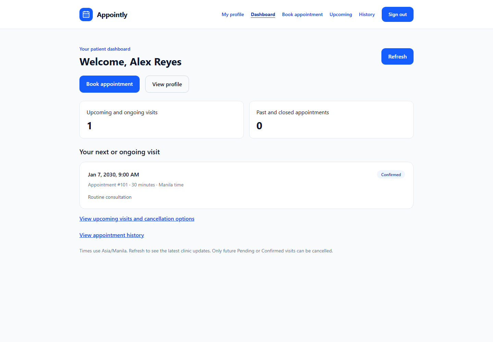
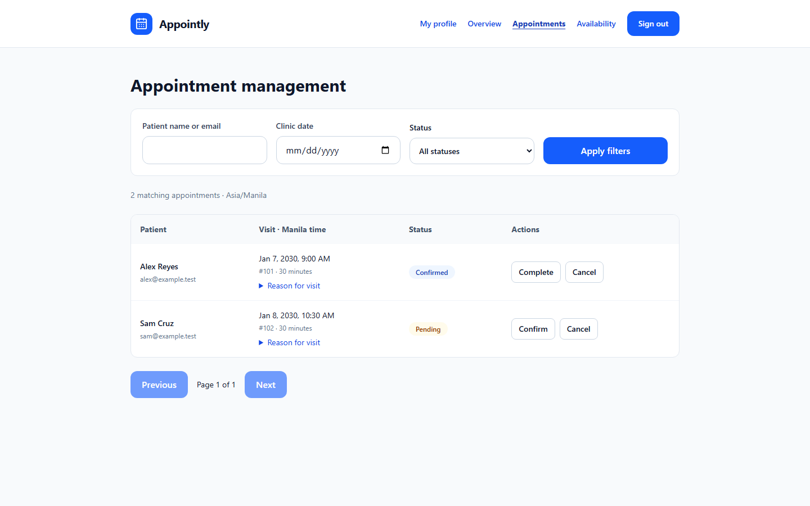
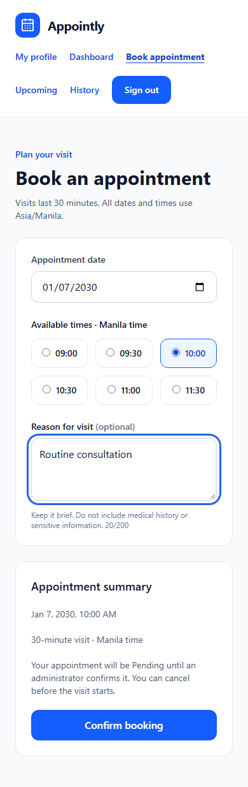

# Appointly

**A clinic appointment booking portfolio built with React, ASP.NET Core, and SQLite.**

Appointly lets patients book and cancel clinic visits while administrators manage appointments, weekly hours, and blocked dates. It demonstrates cookie-based authentication, server-enforced ownership and roles, timezone-aware scheduling, and transactional protection against double booking.

**Status:** the seven planned implementation and documentation phases are complete. The application runs locally; it has not been deployed. Use fictional data only. It is not a production medical records system.

## Screenshots

These are captures of the implemented UI, rendered in Chromium with fictional, mocked API fixtures and a fixed January 2030 clock. They are not screenshots of a deployed service or evidence of live API integration. Capture source is included so the images can be regenerated.

### Patient dashboard



### Administrator appointment management



### Mobile booking



Regenerate with `npm --prefix frontend run screenshots` after installing Chromium as described under Testing. This builds the frontend, starts an isolated preview on port 4178, captures these three pages, and stops the preview. It does not access the application database.

## Features

| Patients | Administrators |
| --- | --- |
| Register, sign in, sign out, and view profile | Sign in with a configured development administrator |
| See the next visit and appointment counts | View database-backed counts and recent bookings |
| Choose an available 30-minute clinic slot | Filter appointments by patient, date, and status |
| Cancel future Pending or Confirmed visits | Confirm, complete, or cancel appointments |
| View upcoming visits and appointment history | Edit weekday hours and block/unblock dates |
| View all appointment times in Asia/Manila | Receive conflicts when changes would invalidate active visits |

Both interfaces include loading, empty, error, and retry feedback. Responsive layouts support narrow screens; wide administration tables scroll within their own region.

## Technology stack

| Layer | Technology |
| --- | --- |
| Frontend | React 19, JavaScript, React Router 7, Vite 8 |
| Styling | Tailwind CSS 4, Lucide icons |
| API | C# and ASP.NET Core 10 controllers |
| Identity | ASP.NET Core Identity with authentication cookies and antiforgery tokens |
| Persistence | Entity Framework Core 10 and SQLite migrations |
| Tests | xUnit, WebApplicationFactory, real temporary SQLite databases, Node test runner, Playwright Chromium |

Dependency versions are recorded in the project files, `global.json`, `dotnet-tools.json`, and `frontend/package-lock.json`.

## Architecture

React pages call the shared Fetch client. During development, Vite proxies `/api` to ASP.NET Core so browser requests stay on one origin. Controllers validate requests and enforce authentication/roles; services enforce booking and administration rules; EF Core stores data in SQLite.

| Responsibility | Main code |
| --- | --- |
| Service registration and HTTP middleware | `backend/Appointly.Api/Program.cs` |
| Identity and HTTP endpoints | `Controllers/`, `Services/IdentitySeeder.cs` |
| Input validation and response shapes | `DTOs/` |
| Booking, ownership, availability, and cancellation | `Services/BookingService.cs` |
| Administrative status and schedule rules | `Services/AdminService.cs` |
| Shared transactional write policy | `Services/ScheduleWriter.cs` |
| Time conversion and slot boundaries | `Services/ClinicTime.cs` |
| Entity mappings and migrations | `Data/AppointlyDbContext.cs`, `Data/Migrations/` |
| Session state and protected navigation | `frontend/src/context/`, `components/RequireAuth.jsx` |
| Cookie/CSRF-aware API requests | `frontend/src/services/api.js` |

### Why bookings remain consistent

Booking, cancellation, status changes, and availability changes acquire an immediate SQLite write transaction before reading the rules they must satisfy. A unique slot reservation provides an additional database constraint. Competing requests cannot both reserve the same active slot, and a closure cannot race a booking into an invalid schedule. Cancelling or completing releases the reservation while retaining appointment history.

Appointments store UTC timestamps; clinic dates and weekly hours use Asia/Manila. Patient history preserves recorded status: viewing an old Pending appointment does not automatically mark it Completed. Status transitions are Pending → Confirmed/Cancelled and Confirmed → Completed/Cancelled; terminal statuses cannot be reactivated.

### C# and ASP.NET Core concepts

- **Dependency injection:** controllers receive services; scoped services share the request's EF Core context. `TimeProvider` is injectable for deterministic tests.
- **DTO records and validation:** request attributes validate input, while response records expose selected fields instead of EF entities.
- **Authorization and claims:** `[Authorize]` protects endpoints. Patient identity comes from authenticated claims rather than a client-supplied user ID.
- **Async queries:** EF calls accept request cancellation tokens. `AsNoTracking()` is used for read-only data.
- **Transactions and constraints:** application validation handles useful errors; SQLite locking and unique keys preserve consistency under concurrency.
- **ProblemDetails:** API failures use structured HTTP errors rather than HTML redirects or leaked exception messages.

## Folder structure

```text
appointly/
├── backend/
│   ├── Appointly.Api/
│   │   ├── Configuration/       # Roles and exception filter
│   │   ├── Controllers/         # HTTP endpoints
│   │   ├── DTOs/                # Request and response contracts
│   │   ├── Data/Migrations/     # EF Core context and schema history
│   │   ├── Models/              # Identity and clinic entities
│   │   └── Services/            # Rules, time conversion, transactions
│   └── Appointly.Tests/         # Real API/SQLite integration tests
├── frontend/
│   ├── src/                    # Components, pages, hooks, services, layouts
│   ├── tests/                  # Browser regression scenarios
│   └── screenshots/            # Reproducible portfolio captures
├── scripts/                    # Admin setup and verification commands
├── docs/                       # Phase guides and screenshot assets
├── Appointly.slnx
├── global.json
└── dotnet-tools.json
```

## Local installation and database setup

Prerequisites: .NET 10 SDK compatible with `global.json` (10.0.203 with newer .NET 10 feature bands allowed), Node.js 24 with npm, Git, and PowerShell for the supplied scripts.

For a fresh checkout:

```powershell
git clone https://github.com/mikeandrei32/Appointly.git
Set-Location Appointly
dotnet tool restore
dotnet restore
dotnet ef database update --project backend/Appointly.Api
npm --prefix frontend ci
```

If the repository is already checked out, run the restore/update/install commands from its root. Stop your running API before migration commands to avoid executable locks.

Migrations create `backend/Appointly.Api/appointly.db`, Identity tables, appointments, slot reservations, weekday schedules, and blocked dates. Default hours are Monday–Friday 09:00–17:00; weekends are closed. Migrations do not seed patients or administrator credentials. The application does not silently apply migrations at startup; apply them before starting the API.

## Run locally

In terminal 1, from the repository root:

```powershell
dotnet run --project backend/Appointly.Api --launch-profile http
```

In terminal 2, from the repository root:

```powershell
npm --prefix frontend run dev
```

Open [Appointly locally](http://localhost:5173). Register a fictional patient and sign in; patients land on `/dashboard`. Administrators land on `/admin`. Stop each server with Ctrl+C.

The API runs at `http://localhost:5080`. Check connectivity with:

```powershell
Invoke-RestMethod http://localhost:5080/api/health
Invoke-RestMethod http://localhost:5173/api/health
```

For local HTTPS, trust the development certificate and use the HTTPS launch profile:

```powershell
dotnet dev-certs https --trust
dotnet run --project backend/Appointly.Api --launch-profile https
```

That profile listens on HTTPS port 7080 and retains HTTP port 5080 for Vite's default proxy.

## Development administrator

After applying migrations, stop any running API and execute:

```powershell
.\scripts\Start-DevelopmentAdmin.ps1
```

The script prompts for an email and hidden password, then starts the API. Use an email not already registered to a patient and a 12–128 character password containing uppercase, lowercase, a digit, and a symbol. Credentials are supplied through process environment variables and are not saved to source files.

The seeder runs only in Development when explicitly enabled. It refuses to promote an existing patient account. Repeating setup with the same admin email keeps the existing account and does not reset its password. Once created, use the normal API startup command and sign in through `/login`. Public registration creates patients only.

## Environment variables and configuration

The API reads normal ASP.NET Core configuration plus optional gitignored `backend/Appointly.Api/appsettings.Local.json`. Environment variables override that local file. Double underscores represent nested configuration keys.

| Variable | Default or purpose |
| --- | --- |
| `ConnectionStrings__DefaultConnection` | `Data Source=appointly.db`; relative to the API content root with the documented launch command |
| `AllowedHosts` | `localhost;127.0.0.1` |
| `Cors__AllowedOrigins__0` | Optional explicit browser origin; no cross-origin access by default; wildcards rejected |
| `ASPNETCORE_ENVIRONMENT` | The supplied launch profiles set `Development` |
| `DevelopmentAdmin__Enabled` | Opt-in admin seeding, used only in Development |
| `DevelopmentAdmin__Email` | Admin setup email; no built-in credential |
| `DevelopmentAdmin__Password` | Admin setup secret; prefer the interactive script |
| `API_PROXY_TARGET` | Frontend Vite proxy target, default `http://localhost:5080` |

Copy `frontend/.env.example` to `frontend/.env` only to change the proxy target. Never place credentials in `VITE_` variables: those values are exposed in browser code. Local configuration, databases, build output, browser traces, and dependencies are ignored by Git.

## Database migrations

Only after intentionally changing the model, generate and review a migration:

```powershell
dotnet ef migrations add DescribeYourChange --project backend/Appointly.Api --output-dir Data/Migrations
dotnet ef database update --project backend/Appointly.Api
```

Commit migration source files, not the SQLite database. Phase 7 requires no new migration.

## API documentation

With the API running in Development, open [OpenAPI JSON](http://localhost:5080/openapi/v1.json), also available through Vite at `http://localhost:5173/openapi/v1.json`. This is a machine-readable specification; Swagger UI is not installed. OpenAPI is not exposed outside Development.

| Area | Routes |
| --- | --- |
| Authentication | `/api/auth/register`, `/login`, `/logout`, `/me`, `/csrf` under `/api/auth` |
| Patient booking | `/api/availability`, `/api/appointments`, `/api/appointments/my`, `/api/appointments/my/overview` |
| Patient appointment | `/api/appointments/{id}`, `/api/appointments/{id}/cancel` |
| Administration | `/api/admin/dashboard`, `/api/admin/appointments`, `/api/admin/appointments/{id}/status` |
| Availability management | `/api/admin/schedules`, `/api/admin/schedules/{id}`, `/api/admin/blocked-dates`, `/api/admin/blocked-dates/{id}` |

Unsafe methods require a fresh token from `/api/auth/csrf` in `X-CSRF-TOKEN`, with the matching cookies. The frontend handles this automatically. Exact methods, payloads, and rules are documented in the phase guides linked below.

## Testing

Install browser binaries once after installing npm dependencies:

```powershell
Push-Location frontend
npx playwright install chromium
Pop-Location
```

Run the full fail-fast verification sequence:

```powershell
.\scripts\Test-Appointly.ps1
```

Or run individual checks:

```powershell
dotnet test --artifacts-path "$env:TEMP/appointly-phase6-checks"
npm --prefix frontend run lint
npm --prefix frontend test
npm --prefix frontend run test:browser
git diff --check
```

The backend test command builds the API and test projects. The browser command builds the production frontend first. The separate backend artifacts directory avoids overwriting an executable held by a running development API.

**Verified during Phase 7:** 69 backend integration cases, two frontend timezone tests, and 20 Chromium browser cases pass, as do lint, builds, and whitespace checks. The separate screenshot capture scenario also passes.

Backend cases use the actual ASP.NET Core pipeline, Identity, and temporary SQLite databases. Browser cases use mocked API responses at desktop and 320-pixel mobile widths, with a Los Angeles browser timezone to check Manila display. Playwright owns a temporary preview on port 4178 and stops it afterward; keep that port free. Browser tests do not touch the application database. Firefox, WebKit, physical devices, and the combined browser-to-real-API workflow remain manual checks.

### Manual smoke test

Register two fictional patients in separate browser sessions. Book a future weekday slot with one; verify the other cannot reserve it. Cancel the booking and verify the slot becomes available and the record appears in history. As admin, confirm/complete visits and try blocking a date with an active booking. Check the conflict message, patient isolation, narrow-screen layout, and Escape/focus behavior in confirmation dialogs.

## Security notes

- Identity hashes passwords and uses HttpOnly authentication cookies. Sessions have 30-minute sliding expiration; production cookies require HTTPS.
- Cookie-authenticated mutations require antiforgery tokens. No authentication token is stored in localStorage.
- Roles and patient ownership are enforced by the API. Unknown JSON properties are rejected, including attempted client role assignment.
- Five failed passwords lock an account for 15 minutes; authentication endpoints share a ten-request-per-IP-per-minute limit.
- Production enables HTTPS redirection and HSTS. CORS requires explicit allowed origins.
- Deployment would need a same-origin reverse proxy, SPA fallback, correct host configuration, persistent Data Protection keys, database backups, and operational monitoring. Those deployment tasks have not been performed.

## Known limitations

- Local portfolio demonstration only; no deployment or healthcare compliance claim.
- One clinic schedule and one appointment per 30-minute slot; no practitioner, room, or multi-clinic capacity model.
- Same-day operating hours only; no overnight schedules.
- No email verification, password-reset UI, reminders, payments, or patient self-rescheduling.
- Patient overview/history loads the patient's full collection; large histories need pagination. Admin appointment lists are paginated.
- Views refresh on navigation or explicit Refresh; there is no real-time push.
- SQLite writes serialize through a shared locking policy. This is not a demonstrated high-throughput deployment.
- Browser automation covers Chromium and mocked responses; it does not replace live integration or accessibility audits.

## Future improvements

Potential future work, not implemented: email verification and password recovery, appointment reminders, patient history pagination, practitioner schedules, rescheduling, broader browser/accessibility tests, CI, and a documented deployment with backups and monitoring. Each would need separate scope and validation.

## Portfolio summary

> Built a full-stack clinic appointment system with React and ASP.NET Core Identity. Implemented patient ownership checks, role-protected administration, UTC/Manila scheduling, and transactional SQLite reservations that prevent concurrent double booking. Verified behavior with real API/database integration tests and browser regression checks, and documented reproducible local setup and UI captures.

## Implementation guides

- [Phase 2: Authentication](docs/phase-2.md)
- [Phase 3: Booking](docs/phase-3.md)
- [Phase 4: Administration](docs/phase-4.md)
- [Phase 5: Patient dashboard and history](docs/phase-5.md)
- [Phase 6: Testing and polish](docs/phase-6.md)
- [Phase 7: Portfolio documentation](docs/phase-7.md)
