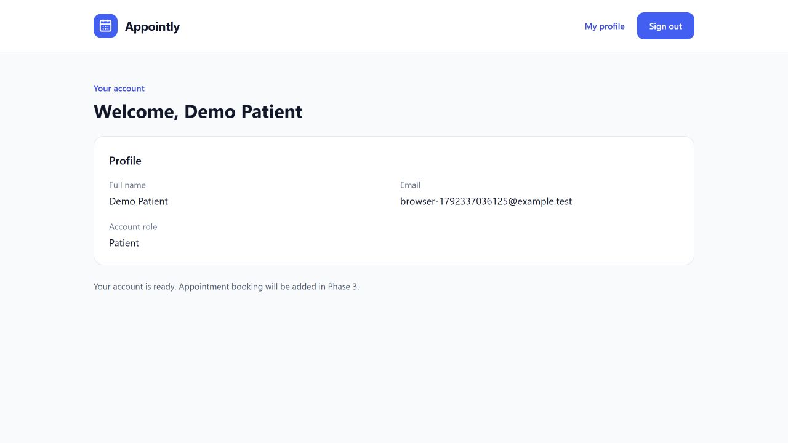

# Phase 2: Authentication

## Implemented

- Patient registration with server validation, password confirmation, and transactional Patient role assignment.
- Identity password hashing, login, logout, and current-user profile.
- HttpOnly authentication cookies, 30-minute sliding sessions, Secure cookies outside Development, SameSite=Lax authentication cookies, and SameSite=Strict CSRF cookies.
- Fresh request tokens from GET /api/auth/csrf; all unsafe controller requests require X-CSRF-TOKEN. Tokens are refreshed across identity changes.
- Five failed passwords lock the account for 15 minutes. Login and registration share a limit of ten requests per IP per minute; excess requests receive 429.
- Administrator-only access verification endpoint. Public registration rejects unknown properties, including role assignments.
- React registration/login pages, success feedback, profile, logout, protected routes, and administrator access page.
- Safe development-only admin seeding with no hardcoded credentials.

## Run after pulling these changes

From the project root, stop the API before updating the database:

```powershell
dotnet restore
dotnet tool restore
dotnet ef database update --project backend/Appointly.Api
dotnet run --project backend/Appointly.Api --launch-profile http
```

In a second terminal:

```powershell
npm --prefix frontend ci
npm --prefix frontend run dev
```

Open http://localhost:5173/register. Use fictional information. Register, follow the success message to login, and verify the profile. Reload to verify cookie session restoration. Sign out, then visit /account: it should redirect to login. A patient visiting /admin is redirected to their account; directly requesting /api/admin/access returns 403.

## Development administrator

Stop the running API first, then run:

```powershell
.\scripts\Start-DevelopmentAdmin.ps1
```

The script prompts for an email and a hidden password. It supplies DevelopmentAdmin__Enabled, DevelopmentAdmin__Email, and DevelopmentAdmin__Password to the API process. It restores the console's previous environment values when the API stops. No credentials are written to source files or passed as command-line arguments.

Use 12-128 characters with uppercase, lowercase, a digit, and a symbol. Use an email that is not registered to a patient. Log in through the normal /login page: the administrator is routed to /admin and the backend verifies access. The seeder is disabled outside Development, even if Enabled is true. Repeating startup with the same admin email preserves that account and does not reset its password. It refuses to promote an existing non-admin account. After the first successful seed, normal startup is sufficient; credentials need not remain configured.

The script itself is intended for interactive local use. Its syntax was checked; the underlying seeding behavior is tested automatically with generated credentials. No user administrator account has been created by the agent.

## API

| Method | Route | Access |
| --- | --- | --- |
| GET | /api/auth/csrf | Public; obtains token and matching HttpOnly cookie |
| POST | /api/auth/register | Public + CSRF; creates Patient only; 201 |
| POST | /api/auth/login | Public + CSRF; sets session cookie; 200 |
| POST | /api/auth/logout | Authenticated + CSRF; clears cookie; 204 |
| GET | /api/auth/me | Authenticated; safe profile DTO |
| GET | /api/admin/access | Admin only; actual authorization verification |

Register fields: fullName, email, password, confirmPassword. Login fields: email, password. Invalid validation/CSRF returns 400; unauthenticated requests return 401; insufficient role returns 403. These endpoints return status codes instead of redirecting to HTML login pages. Development API details remain at /openapi/v1.json. /api/admin/access is a Phase 2 verification endpoint, not a dashboard with placeholder statistics.

## Class responsibilities and data flow

- ApplicationUser inherits IdentityUser and adds FullName and CreatedAtUtc. Identity provides password hashes and account security fields.
- AppointlyDbContext now inherits IdentityDbContext<ApplicationUser>; its migration adds users, roles, claims, tokens, and user-role relationships while preserving clinic schedules.
- AuthController receives UserManager, SignInManager, the database context, and antiforgery service through constructor dependency injection. Identity performs password checking and cookie issuance.
- AuthRequests validates incoming values; UserResponse exposes only id, name, email, and roles. No password hash is returned.
- IdentitySeeder creates standard roles and optionally a development administrator. The admin creation and role assignment are transactional.
- AppRoles centralizes role names. AdminAccessController uses the Admin role attribute, independent of frontend route checks.
- api.js includes cookies in Fetch requests and obtains a fresh CSRF token before each mutation. Authentication tokens are never stored in localStorage.
- AuthProvider manages the current user and session loading. RequireAuth handles routing; the backend remains the authority for access.
- Button, Input, and ErrorMessage are reusable controls. AuthLayout and AccountLayout separate shared layout from individual page logic.

## Verification

```powershell
dotnet test
npm --prefix frontend run lint
npm --prefix frontend run build
```

The ten integration cases use real temporary SQLite files and apply EF migrations. Coverage includes registration/login/profile/logout, hashed passwords, cookie attributes, anonymous 401 responses, Patient-to-Admin denial, missing/stale CSRF, supplied role rejection, validation, duplicate email rejection, wrong credentials, lockout, rate limiting, development admin access/idempotency, prevention of patient promotion, and disabling development seeding/OpenAPI in Production. The test fixture cleans up its temporary databases.

Browser checks cover patient registration, login, session persistence, patient admin-route restriction, and logout. One fictional browser-test patient remains in the ignored local development database. No real patient data was used.

## Limits and next phase

There is no password recovery or email verification flow yet; neither is claimed as implemented. The administrator screen currently verifies real role authorization. Booking and scheduling functionality starts in Phase 3. Cross-site cookies, deployment proxy configuration, and a full mobile/device test matrix are not part of this phase. When deploying behind a reverse proxy, configure trusted forwarded headers and review IP-based rate limiting before deployment.

## Verified preview



The screenshot uses the fictional browser-test account described above.
